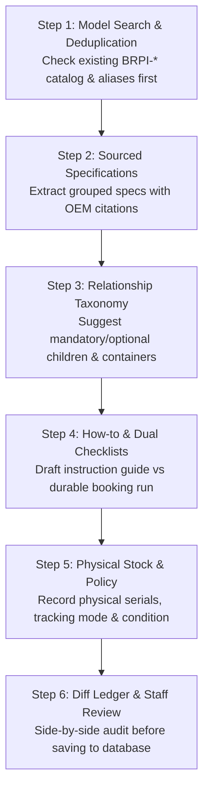

# Babin Rentals — Smart Add Equipment Workflow & Relationship Taxonomy

This reference implements the **6-Step Smart Equipment Workflow** and **Canonical Relationship Taxonomy** established in the Babin Rentals Master Integration Plan (23 Nov 2026).

---

## 1. Non-Negotiable Core Rules

1. **One Authoritative Catalogue & Asset Ledger:** Never invent or maintain a parallel database of serials, models, or stock.
2. **One Pricing Engine:** Base rates, multi-day discounts, deposits, advances, and taxes are governed by Babin Rentals OS. Intelligence engines may suggest or explain, but never unilaterally mutate prices.
3. **AI Proposes, Staff Approves:** Never invent serial numbers, SKUs, local prices, warranty dates, or physical specifications. Unverified claims remain labeled `UNKNOWN_NEEDS_VERIFICATION`.
4. **Draft $\neq$ Approved $\neq$ Published:** Separate internal draft guidance from staff-approved internal notes and public/client-facing guides.
5. **No Client-Side Asset Code Minting:** Asset codes are issued strictly on database commit via locked counter (`next_document_number`).
6. **Nepal Whole Rupee Standard (RULINGS-2026-11-22):** Display all rental rates, totals, and balances in whole rupees (`Rs 2,100`), suppressing decimals and paisa.

---

## 2. The 6-Step Smart Equipment Entry Pipeline

### Step 1 — Model Search & Deduplication
- **Objective:** Prevent creating duplicate models for equipment already present in inventory.
- **Action:** Query the local catalogue using `normalize_identifier`.
- **Result:**
  - If existing model matches: Open existing model for review or updating.
  - If alias matches: Suggest canonical model name (e.g. `Sony FX3` $\to$ `BRPI-SONY-FX3A-BODY`).
  - If new: Proceed to Step 2 draft.

### Step 2 — Suggest Specifications & Catalogue Fields
- **Grouped Categories:**
  - **Identity:** Brand, Normalized Model Name, Category/Subcategory, Searchable Aliases.
  - **Optical / Sensor:** Mount format, Sensor dimensions, Dynamic range, Base ISOs.
  - **Power & Media:** Continuous Wattage draw, approved media formats, battery bay type.
  - **Handling & Risk:** Weight, fragile components, skill requirement (Beginner vs DP).
- **Evidence Annotations:** Every fact must carry a provenance tag:
  - `OEM_DOCUMENTED` (from official manufacturer datasheet / manual)
  - `BABIN_BENCH_TESTED` (from internal verified technician bench tests)
  - `UNREVIEWED_DRAFT` (requires staff confirmation before publishing)

### Step 3 — Suggest Child Items, Dependencies & Packaging
- **Canonical Relationship Taxonomy:**
  | Relation Type | Meaning | Operational / Financial Behavior |
  |---|---|---|
  | `included_mandatory` | Core component of standard kit | Auto-inherited on packing list; no extra charge |
  | `included_optional` | Selectable kit inclusion | Tracked on packing list only if selected |
  | `required_to_operate` | Technical dependency | Blocking warning raised if omitted |
  | `compatible_accessory` | Verified mechanical/electrical fit | Suggested in UI; optional addition |
  | `recommended_addon` | Strategic upsell / enhancement | Suggested with clear client benefit and price delta |
  | `chargeable_extra` | Separately priced line item | Calculated as individual line item in quote |
  | `containment` | Master physical container | `stored_in` field (one container at a time) |
  | `bundle_component` | Template bundle member | Allocated via bundle reservation rules |

### Step 4 — How-To Guidance & Dual Checklist Separation
- **Model How-To Guide:**
  - Quick Start Steps, Safety Warnings, Common Pitfalls, Staff Talking Points.
- **Dual Checklist Model:**
  - **Instructional Guide Template:** Static reference checklist attached to model.
  - **Durable Operational Checklist Run:** Instance tied to `booking_id`, `asset_serial_id`, `technician_user_id`, `timestamp_iso`, and `photo_evidence_url`. Local checkbox clicks do not count as operational custody sign-offs.

### Step 5 — Physical Stock & Rental Policy
- **Tracking Modes (Exactly 3):**
  - `Serialised`: One row per physical unit with exact manufacturer serial.
  - `Quantity`: Bulk items tracked by count (cables, sandbags, adapters).
  - `Consumable`: Items consumed and never returned (gaffer tape, gels, fog juice).
- **Intake Conditions (Exactly 5):**
  - `Excellent`, `Good`, `Fair`, `Damaged`, `Lost`.
  - *(Note: `Repair Required` is an operational routing destination, not an intake condition).*

### Step 6 — Review Ledger & Safe Commit
- Generate side-by-side diff ledger comparing `before` vs `after`.
- Highlight unresolved unknowns.
- Write audit log event upon staff approval.
