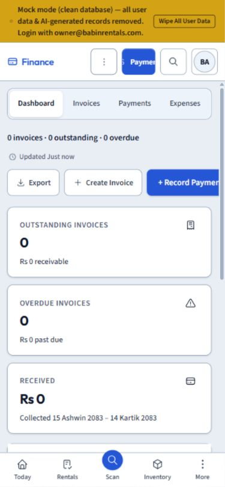

# ASTRA UI / UX Audit

Audit date: 18–19 October 2026 (Asia/Katmandu). Repository: https://github.com/babindulal7/babin-rentals-os. Baseline: latest accessible main, ad8ce1e4afc54cc88df841425d0e281bd15665bc, fetched 18 October and rechecked 19 October. All file references are relative to that immutable revision.

Audit only: no application fixes, merge, deployment, production database access or production mutations. Local SQL probes used disposable PGlite fixtures. Browser used a separate mock preview at 127.0.0.1:3026.

## What was actually exercised

In-app browser recovered after Chrome connection timeouts. Owner mock sign-in, Today, New Rental, primary module landing pages and selected high-risk reports were rendered. Data was empty/mock: this proves route/render behavior, not live CRUD. Mock report pages displayed invented totals despite empty primary lists; source proves these fallbacks are not mock-only (WF-01–05). No live booking/payment/claim was created.

## Responsive evidence

| Width | Today | New Rental | Other scope |
|---|---|---|---|
|375|Rendered; date control truncates and Next7Days wraps; screenshot|Rendered single column; duration double-selection; screenshot|Finance payment action clipped (UI-05)|
|430|Captured; no document horizontal overflow measured|Captured; no document horizontal overflow|Other flows NOT VERIFIED|
|768|Captured with desktop-style icon navigation|Captured, stacked form|Other flows NOT VERIFIED|
|820|Screenshot inspected; desktop IA with collapsed sidebar, stacked cards|Captured|Finance screenshot inspected; duplicate actions|
|1024|Captured; no document horizontal overflow|Captured|Other flows NOT VERIFIED|
|1440|Captured; two-column Today|Captured|Primary route smoke at this width|
|1920|Screenshot inspected; two-column Today|Captured|Other flows NOT VERIFIED|

Screenshots are audit-evidence/today-WIDTH.png and new-rental-WIDTH.png. Resize captures do not prove interaction, keyboard focus or every nested popup at those dimensions. Several early rapid-resize captures may include transition frames; only explicitly inspected settled views support visual findings. Today 375, Today820, Today1920, NewRental375 and Finance375/820 were inspected separately after layout settled. Do not award all-device acceptance from this matrix.

## Verified consistency/usability defects

- **UI-01: Production packages are seeded and saved only in shared localStorage** — getProductions falls back to six fictional packages without IS_MOCK gate; writes use br.productions localStorage. Browser displayed six packages in otherwise empty mock corpus. No backend action/RLS/audit persistence in this query module. Source: src/lib/queries/productions.ts:38–42,146–184; src/App.tsx:199–207.
- **UI-02: Shift handover records are local-only and Recount Cash claims an action it does not open** — Seeded/localStorage records feed Today. Completion toast invents a 14:0x timestamp using Math.random. Recount handler only emits a success toast. Source: src/lib/queries/shiftHandover.ts:46–117; src/modules/today/ShiftHandoverPanel.tsx:154–169.
- **UI-03: Warranty claims update local sample records; hidden monetary default remains writable** — Unconditionally seeded/localStorage warranty data. claimAmount defaults to10000; handleRecordClaim changes local data with Number(...) and success toast. Money visibility hides presentation rather than authorizing write. Source: src/lib/queries/warranty.ts:32–99; src/modules/inventory/WarrantyTracker.tsx:49–87.
- **UI-04: Closing nested modal releases outer modal scroll lock** — Audit component test opens outer with dormant inner, opens then closes inner. Expected body overflow hidden; observed empty string. Source: src/components/ui/Modal.tsx:33–37,138–148; audit-evidence/modal-lock.test.tsx:18.
- **UI-05: Duplicate phone action row clips Record Payment** — At375px Owner Finance renders Export/Create Invoice/+ Record Payment despite header More/Payment. Payment bounds left244.93 right390.93 >375. Existing Finance.restricted test fails same policy. Tablet screenshot also shows duplicate header/body action hierarchy. Source: src/modules/finance/Finance.tsx (ModuleSubHeader secondaryActions/primaryAction); audit-evidence/finance-375.png.
- **UI-06: One-day and two-day duration presets can both be selected** — Default out Oct19 09:00 / return Oct20 18:00 yields two operational days. aria-pressed is true for both1day and2days because date equality OR computed day equality activate separate presets. Browser AX confirms both checked. Source: src/modules/rentals/booking/DatePresets.tsx:85–91.

Today remains the central floor workspace. No duplicate operations center is recommended. Prefer one primary action area, predictable secondary overflow, consistent error/empty/loading treatment and a single status vocabulary backed by facts. Booking state is Quote→Booked→Packed→On Rent→Returned→Closed; Packing/Handover/Inspection/Reset are workspaces/session progress, not extra booking enum values. Draft is local form persistence; cancellation and archive are flags.

## Full declared route inventory

Every literal route in App.tsx is included below, including aliases. Parameterized detail routes have no seeded record in the clean mock preview and are not runtime-certified. Source presence is not a verified functional screen. UNBUILT is derived from NAV; the source’s built-root list is structural bookkeeping, not business acceptance.

| Route | Declaration | Runtime evidence |
|---|---|---|
| /login | src/App.tsx:123 | Owner mock quick sign-in executed |
| /forgot-password | src/App.tsx:135 | NOT VERIFIED; declaration inventoried |
| /reset-password | src/App.tsx:136 | NOT VERIFIED; declaration inventoried |
| / | src/App.tsx:137 | NOT VERIFIED; declaration inventoried |
| /reports | src/App.tsx:144 | NOT VERIFIED; declaration inventoried |
| /admin | src/App.tsx:157 | NOT VERIFIED; declaration inventoried |
| /tools/audit-log | src/App.tsx:158 | NOT VERIFIED; declaration inventoried |
| /tools/activity-log | src/App.tsx:159 | NOT VERIFIED; declaration inventoried |
| /tools/numbering | src/App.tsx:160 | NOT VERIFIED; declaration inventoried |
| /tools/backup | src/App.tsx:161 | NOT VERIFIED; declaration inventoried |
| /clients | src/App.tsx:164 | Owner mock landing rendered; full interactions NOT VERIFIED |
| /clients/new | src/App.tsx:174 | NOT VERIFIED; declaration inventoried |
| /dashboard | src/App.tsx:177 | NOT VERIFIED; declaration inventoried |
| /today | src/App.tsx:182 | Owner mock landing rendered; full interactions NOT VERIFIED |
| /rentals | src/App.tsx:191 | Owner mock landing rendered; full interactions NOT VERIFIED |
| /rentals/productions | src/App.tsx:200 | Owner mock landing rendered; full interactions NOT VERIFIED |
| /rentals/new | src/App.tsx:209 | NOT VERIFIED; declaration inventoried |
| /rentals/:bookingNo/packing | src/App.tsx:213 | NOT VERIFIED; declaration inventoried |
| /rentals/:bookingNo/handover | src/App.tsx:224 | NOT VERIFIED; declaration inventoried |
| /rentals/:bookingNo/return | src/App.tsx:235 | NOT VERIFIED; declaration inventoried |
| /rentals/:bookingNo/reset | src/App.tsx:246 | NOT VERIFIED; declaration inventoried |
| /rentals/:bookingNo/evidence | src/App.tsx:257 | NOT VERIFIED; declaration inventoried |
| /rentals/:bookingNo | src/App.tsx:273 | NOT VERIFIED; declaration inventoried |
| /crew | src/App.tsx:284 | Owner mock landing rendered; full interactions NOT VERIFIED |
| /crew/timesheet | src/App.tsx:293 | NOT VERIFIED; declaration inventoried |
| /inventory | src/App.tsx:302 | Owner mock landing rendered; full interactions NOT VERIFIED |
| /inventory/warranty | src/App.tsx:311 | Owner mock landing rendered; full interactions NOT VERIFIED |
| /inventory/new | src/App.tsx:323 | NOT VERIFIED; declaration inventoried |
| /inventory/warehouses | src/App.tsx:329 | NOT VERIFIED; declaration inventoried |
| /inventory/stock-check | src/App.tsx:331 | NOT VERIFIED; declaration inventoried |
| /inventory/sub-rentals | src/App.tsx:332 | NOT VERIFIED; declaration inventoried |
| /inventory/sub-rental | src/App.tsx:333 | NOT VERIFIED; declaration inventoried |
| /inventory/purchase-requests | src/App.tsx:336 | NOT VERIFIED; declaration inventoried |
| /inventory/:assetId | src/App.tsx:352 | NOT VERIFIED; declaration inventoried |
| /inventory/bundles/new | src/App.tsx:364 | NOT VERIFIED; declaration inventoried |
| /inventory/bundles/:bundleRef | src/App.tsx:380 | NOT VERIFIED; declaration inventoried |
| /inventory/bundles/:bundleRef/edit | src/App.tsx:401 | NOT VERIFIED; declaration inventoried |
| /calendar | src/App.tsx:406 | Owner mock landing rendered; full interactions NOT VERIFIED |
| /documents | src/App.tsx:414 | NOT VERIFIED; declaration inventoried |
| /operations | src/App.tsx:417 | Owner mock landing rendered; full interactions NOT VERIFIED |
| /inventory/cases | src/App.tsx:429 | NOT VERIFIED; declaration inventoried |
| /inventory/cases/:id | src/App.tsx:440 | NOT VERIFIED; declaration inventoried |
| /operations/cases | src/App.tsx:449 | NOT VERIFIED; declaration inventoried |
| /operations/cases/:id | src/App.tsx:450 | NOT VERIFIED; declaration inventoried |
| /operations/crew | src/App.tsx:454 | NOT VERIFIED; declaration inventoried |
| /operations/sub-rental | src/App.tsx:457 | NOT VERIFIED; declaration inventoried |
| /operations/delivery | src/App.tsx:466 | NOT VERIFIED; declaration inventoried |
| /notes | src/App.tsx:475 | Owner mock landing rendered; full interactions NOT VERIFIED |
| /team/notes | src/App.tsx:482 | NOT VERIFIED; declaration inventoried |
| /operations/notes | src/App.tsx:483 | NOT VERIFIED; declaration inventoried |
| /finance | src/App.tsx:486 | Owner mock landing rendered; full interactions NOT VERIFIED |
| /finance/closing | src/App.tsx:504 | NOT VERIFIED; declaration inventoried |
| /finance/invoices | src/App.tsx:505 | NOT VERIFIED; declaration inventoried |
| /finance/payments | src/App.tsx:506 | NOT VERIFIED; declaration inventoried |
| /finance/expenses | src/App.tsx:507 | NOT VERIFIED; declaration inventoried |
| /finance/documents | src/App.tsx:508 | NOT VERIFIED; declaration inventoried |
| /finance/reports | src/App.tsx:509 | NOT VERIFIED; declaration inventoried |
| /reports/pulse | src/App.tsx:512 | NOT VERIFIED; declaration inventoried |
| /reports/expenses | src/App.tsx:521 | NOT VERIFIED; declaration inventoried |
| /reports/clients | src/App.tsx:533 | NOT VERIFIED; declaration inventoried |
| /reports/promotions | src/App.tsx:542 | NOT VERIFIED; declaration inventoried |
| /reports/staff | src/App.tsx:551 | NOT VERIFIED; declaration inventoried |
| /reports/inventory | src/App.tsx:560 | NOT VERIFIED; declaration inventoried |
| /reports/products | src/App.tsx:573 | NOT VERIFIED; declaration inventoried |
| /reports/equipment-performance | src/App.tsx:582 | NOT VERIFIED; declaration inventoried |
| /reports/asset-roi | src/App.tsx:591 | Owner mock landing rendered; full interactions NOT VERIFIED |
| /reports/forecasting | src/App.tsx:600 | NOT VERIFIED; declaration inventoried |
| /reports/cash-flow | src/App.tsx:609 | NOT VERIFIED; declaration inventoried |
| /reports/working-capital | src/App.tsx:618 | NOT VERIFIED; declaration inventoried |
| /reports/rentals | src/App.tsx:627 | Owner mock landing rendered; full interactions NOT VERIFIED |
| /reports/operations | src/App.tsx:636 | Owner mock landing rendered; full interactions NOT VERIFIED |
| /reports/damage-maintenance | src/App.tsx:645 | NOT VERIFIED; declaration inventoried |
| /reports/sales | src/App.tsx:654 | Owner mock landing rendered; full interactions NOT VERIFIED |
| /reports/vat-tax | src/App.tsx:663 | NOT VERIFIED; declaration inventoried |
| /reports/activity | src/App.tsx:672 | NOT VERIFIED; declaration inventoried |
| /reports/revenue | src/App.tsx:681 | NOT VERIFIED; declaration inventoried |
| /reports/cases | src/App.tsx:689 | NOT VERIFIED; declaration inventoried |
| /reports/custom | src/App.tsx:697 | NOT VERIFIED; declaration inventoried |
| /clients/memberships | src/App.tsx:705 | NOT VERIFIED; declaration inventoried |
| /clients/import | src/App.tsx:706 | NOT VERIFIED; declaration inventoried |
| /clients/duplicates | src/App.tsx:707 | NOT VERIFIED; declaration inventoried |
| /clients/referral/new | src/App.tsx:708 | NOT VERIFIED; declaration inventoried |
| /clients/:id | src/App.tsx:714 | NOT VERIFIED; declaration inventoried |
| /settings | src/App.tsx:729 | Owner mock landing rendered; full interactions NOT VERIFIED |
| /admin/audit | src/App.tsx:740 | NOT VERIFIED; declaration inventoried |
| /admin/audit-settings | src/App.tsx:752 | NOT VERIFIED; declaration inventoried |
| /tools | src/App.tsx:760 | Owner mock landing rendered; full interactions NOT VERIFIED |
| /tools/depreciation | src/App.tsx:768 | NOT VERIFIED; declaration inventoried |
| /tools/pricing | src/App.tsx:769 | NOT VERIFIED; declaration inventoried |
| /admin/audit-log | src/App.tsx:772 | Owner mock landing rendered; full interactions NOT VERIFIED |
| /admin/activity-log | src/App.tsx:781 | NOT VERIFIED; declaration inventoried |
| /admin/numbering | src/App.tsx:790 | NOT VERIFIED; declaration inventoried |
| /admin/backup | src/App.tsx:799 | NOT VERIFIED; declaration inventoried |
| /tools/cinematography | src/App.tsx:813 | NOT VERIFIED; declaration inventoried |
| /settings/tools | src/App.tsx:814 | NOT VERIFIED; declaration inventoried |
| * | src/App.tsx:829 | NOT VERIFIED; declaration inventoried |

New Rental is /rentals?action=new, rendered separately. Query tabs (Inventory equipment/bundles/stock/maintenance/stats; Clients directory/membership/import/duplicates/referral; Finance dashboard/invoices/payments/expenses/documents/closing/reports; Settings business/people/branches/system; Tools calculator families) are additional interaction surfaces, not independently certified by the route inventory.

## Module-by-module acceptance ledger

| Module | Assessed evidence | Remaining verification |
|---|---|---|
|Today|Day-anchor source/repro; seven widths; empty cards; local shift panel|Populated queues, stale/error states, every day filter with real data|
|New Rental|Form sections/controls and seven widths; pricing/date engine controls|Full real creation, picker keyboard/mobile, conflicts, draft recovery, every optional service|
|Rentals / detail|List empty state; lifecycle SQL; existing test suite|Every status/detail action in browser, archive search and error/retry|
|Operations four steps|Shared shell/source and SQL session gates; empty queue rendered|Packing/accessories, late extras, serial scans, partial handover/return, damage/reset across devices|
|Inventory / bundles|Empty catalogue rendered; SQL update/bundle/capacity gates|Search/pagination/serial/quantity UI, stock audits and maintenance workflows|
|Clients|Empty directory; atomic-client SQL gate; search copy defect in tests|Full registration/history/import/duplicates/membership and PII role scenarios|
|Calendar|Month/Week/Timeline/Availability controls rendered; date query inspected|Populated overlaps, every view/filter, touch navigation|
|Finance/payment/deposits|Empty dashboard, phone/tablet; settlement/void/reversal gates|Real receipts/refunds/deposit close, export and reconciliation|
|Reports|Revenue trend source; six report engines in depth; four rendered|All remaining report families and chart interactions; arbitrary date/branch data sets|
|Documents|Routes/queries and storage policy; createDocument tests|PDF layout/signatures, uploads/downloads, browser print, role-bound links|
|Crew/timesheets|Mock roster rendered; mock gate seen in query|Live assignment/payroll/timesheet synchronization; no claim demo roster is live failure|
|Maintenance/cases/warranty|Warranty local implementation; damage report source|Case transitions/parts/holds/claims with real records and roles|
|Staff/Settings|Settings rendered; role SQL probe and policy matrix|Real Auth provisioning, deactivation/session expiry and every settings control|
|Audit/activity logs|Audit-log page rendered; audit INSERT attack reproduced|Drawer category classifier; every export/date filter; audit retention operational test|
|Productions|Route rendered; seeded/local persistence verified|Actual linked production business workflow missing from this implementation|
|Notes/shift|Seed/local query and Today panel inspected|Cross-device persistence, confidentiality and complete note lifecycle|
|Tools/admin/backup|Tools menu rendered; route declarations|Every calculator, numbering, import/export, restore drill and integrations|
|Public marketing / desktop wrapper|Entry/bundle configuration inventoried|Browser marketing, Electron sandbox/update/distribution NOT VERIFIED|

## Accessibility limits

Theme contrast gate passed82 pairs; this is token contrast, not whole-page accessibility. Shared Modal nested-scroll failure reproduced. Status text/icon patterns and skip links are present. Screen reader, full focus order, all target sizes, zoom200%, reduced motion, dark theme and touch hardware tests remain NOT VERIFIED. No universal WCAG certification is made.
