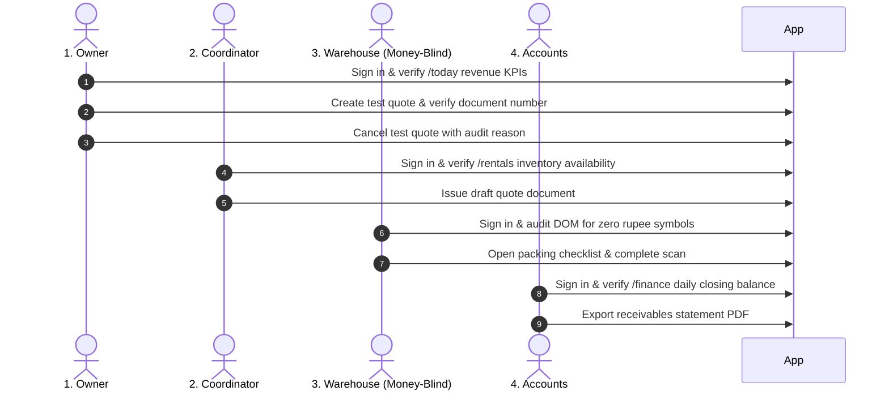

# Live Multi-Role Smoke Test Runbook (Card T1-11)

**Card:** T1-11 · Live smoke test per role  
**Scope:** Production & Staging Verification Runbook following database batches and cutover drills  
**Authority:** [AGENTS.md](../../AGENTS.md) · [CLAUDE.md](../../CLAUDE.md) · [PERMISSIONS.md](../PERMISSIONS.md)  
**Operator:** Babin Dulal (Owner) / Lane Leads / Floor Staff  
**Environments:** Staging (`klhmsrunqrdxjudyhnkm`), Production (`sxguwvgoserhdolewibb`, read-only audit / explicit window)  

---

## 1. Objectives & Safety Invariants

This runbook provides the repeatable, step-by-step procedure to certify that a deployed database batch or release candidate behaves correctly for each staff role.

### Non-Negotiable Invariants:
1. **Law 1:** Business logic is executed by engines in `src/lib/` and database RPCs; UI components only present state and collect inputs.
2. **Law 3 (Terminal Actions Only):** No entities are hard-deleted. A test quote is terminated via explicit cancellation with a recorded reason and audit trail.
3. **Law 5 (Deposit Segregation):** Security deposits are tracked strictly as liabilities, never added to Rental Total or reducing Outstanding balances.
4. **Law 6 (Absolute Money Blindness):** The `Warehouse`, `Technician`, `Driver`, and `Client` roles **never** receive monetary amounts, rate numbers, or discount percentages in the DOM, state, or network payloads.
5. **Touch Targets & Contrast:** All primary action buttons are $\ge 44\text{px}$ (and floor verbs $\ge 56\text{px}$); contrast adheres to WCAG AA.

---

## 2. Test Execution Sequence

Run through the 4 roles sequentially. Record all timestamps and operator initials in `PROGRESS.md`.

---

### Step 1: Owner Role Verification

- **Identity:** `staging-owner@babinrentals.test` (or Owner production credential).
- **Procedure:**
  1. Sign in to the application.
  2. **Navigate to `/today`:**
     - [ ] Verify KPI metric cards render: Total Bookings, Active Rentals, Due Returns, Revenue Today.
     - [ ] Confirm currency amounts display in proper lakh grouping (e.g., `Rs 1,85,000`).
     - [ ] Confirm no console errors or layout overflow at 375px, 820px, and 1440px.
  3. **Create a Test Quote (`BK-SMOKE-TEST-01`):**
     - [ ] Navigate to `/rentals` -> Click **New Rental**.
     - [ ] Select client (e.g., `C-9901` Staging Production Client Pvt Ltd).
     - [ ] Select pickup date (Tomorrow 08:00) and return date (3 days later 20:00).
     - [ ] Add 1 Camera Kit (e.g., Sony FX6). Confirm live availability shows green checkmark.
     - [ ] Save as **Draft Quote**. Verify assigned monotonic document code (format `BK-YYYY-NNNN`).
  4. **Cancel the Test Quote (Law 3):**
     - [ ] Open the newly created quote detail view.
     - [ ] Click **Cancel Booking** -> Enter reason: `"Cutover smoke test verification"`.
     - [ ] Confirm status updates to `Cancelled` with clear red/neutral pill.
     - [ ] Verify audit log entry is recorded with actor ID, timestamp, and cancellation rationale.

---

### Step 2: Rental Coordinator Role Verification

- **Identity:** `staging-coordinator@babinrentals.test` (or Coordinator production credential).
- **Procedure:**
  1. Switch to Coordinator via PIN (4-digit switch, e.g., `1234`) or login.
  2. **Navigate to `/rentals`:**
     - [ ] Verify booking list loads with filters (All, Quote, Confirmed, On Rent, Returned).
     - [ ] Verify filter persistence when toggling tabs and returning.
  3. **Check Availability & Serial Allocation:**
     - [ ] Select an active inventory item. Confirm serial allocation sheet allows picking specific units (e.g., `FX6-STG-001`).
     - [ ] Verify that external holds (Booqable held gear) display neutral non-selectable chips and cannot be reserved for conflicting dates.
  4. **Document Generation:**
     - [ ] Open a confirmed booking and verify quote PDF generation preview renders correct VAT (13%) and advance required amounts.

---

### Step 3: Warehouse / Floor Role Verification (Law 6 Money-Blindness Audit)

- **Identity:** `staging-warehouse@babinrentals.test` (or Warehouse floor account).
- **Procedure:**
  1. Switch to Warehouse role.
  2. **Strict DOM & Network Audit:**
     - [ ] Open Browser DevTools (Elements & Network tabs).
     - [ ] Navigate to `/today`, `/rentals`, and open a Booking Detail screen.
     - [ ] Search DOM (Ctrl+F) for: `Rs`, `NPR`, `रु`, `daily_rate`, `subtotal`, `discount`, `vat`, `total_paisa`.
     - [ ] **Pass condition:** Exactly **0** monetary figures appear in the DOM text, attributes, or API responses returned to the client.
  3. **Packing Checklist Flow:**
     - [ ] Open the Packing tab for an upcoming booking.
     - [ ] Verify touch targets on "Mark Packed" / "Scan Item" are $\ge 56\text{px}$ on mobile/tablet viewports.
     - [ ] Tap to check off an item -> Confirm green indicator updates instantly.
  4. **Handover & Return Verification:**
     - [ ] Test glass signature input field (Law 17 pickup verification).
     - [ ] Verify condition options (`Good`, `Needs Cleaning`, `Damaged`) appear during return inspection.
     - [ ] Verify damage photo upload gate triggers if `Damaged` is selected (L68 lifecycle invariant).

---

### Step 4: Accounts Role Verification

- **Identity:** `staging-accounts@babinrentals.test` (or Accounts production credential).
- **Procedure:**
  1. Switch to Accounts role.
  2. **Navigate to `/finance`:**
     - [ ] Confirm financial overview loads: Total Invoiced, Collected, Outstanding, Security Deposits Held.
     - [ ] Verify security deposits are clearly segregated under "Liabilities" (Law 5).
  3. **Daily Closing Ledger:**
     - [ ] Open Daily Closing view (`/finance/closing`).
     - [ ] Verify cash collected, online/Fonepay QR payments, and bank transfers reconcile with zero variance.
  4. **Receivables & Statements:**
     - [ ] Open Who Owes (`/finance/receivables`).
     - [ ] Select a client with an outstanding balance.
     - [ ] Click **Export Statement PDF** -> Verify generated document is clean and properly formatted.

---

## 3. Screen Check Verification Matrix (docs/USABILITY_TESTS.md §1)

On each verified screen during the smoke test, evaluate the 8 universal usability assertions:

| Usability Rule | Assertion | Verified |
|---|---|:---:|
| **1. Which screen** | Clear heading immediately identifies current module and view | [x] |
| **2. Which booking/entity** | Contextual header clearly shows active booking code / client name | [x] |
| **3. Where am I** | Active breadcrumb and highlighted navigation bar item | [x] |
| **4. Next action** | Primary action button is prominent, unambiguous, and $\ge 44\text{px}$ ($\ge 56\text{px}$ for floor) | [x] |
| **5. Search and exit** | Search bar and cancel/back buttons are visible without scrolling | [x] |
| **6. No false saves** | Changes only report success after database RPC confirmation | [x] |
| **7. Touch ergonomics** | All tappable controls have at least 8px spacing; no cramped icons | [x] |
| **8. Forgiving forms** | Field validation errors are displayed inline; inputs preserve typed values on error | [x] |

---

## 4. Sign-Off & Verification Logging

When all 4 roles pass the checklist:
1. Log the execution entry in `PROGRESS.md` under `## Cutover Verification`.
2. Format: `YYYY-MM-DD HH:MM NPT — Card T1-11 Smoke Test PASSED by [Operator Initials] across Owner, Coordinator, Warehouse, Accounts`.
3. If any step fails, log a P0/P1 ticket immediately and halt release progression.
