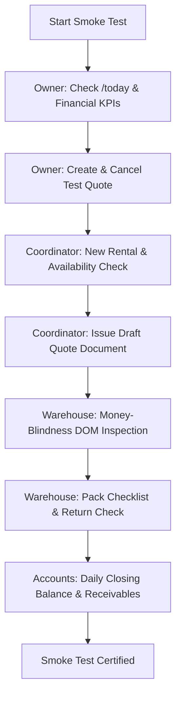

# Cutover Dry Run & Supervised Operational Pilot Protocol

**Document type:** Operational Runbook & Acceptance Specification (`.md`)  
**Target Milestone:** Week 4 (December 15–21, 2026)  
**Launch Target:** Thursday, 31 December 2026 (Controlled Internal Launch)  
**Governing Rules:** [DECEMBER_31_LAUNCH_PLAN.md](../plans/DECEMBER_31_LAUNCH_PLAN.md) §4 · Rule N-5 (No unauthorized prod changes) · Rule N-8 (Zero credentials in code)  
**Lead Roles:** Babin Dulal (Owner) · Assigned Lane Leads · Windows Antigravity (Automation & Test Harness)  

---

## 1. Executive Summary & Purpose

The purpose of the **Cutover Dry Run & Supervised Operational Pilot** is to rehearse every operational, administrative, and technical step of the December 31 launch under controlled conditions before live production cutover.

A release is **not certified** by passing automated tests alone. Week 4 enforces empirical verification across six core operational domains:
1. **Pre-Cutover Parity & Freeze:** Verification that codebase, migrations, and environment configurations match exactly.
2. **Read-Only Maintenance & Snapshot Routine:** Exercising database freezing and offline tabular snapshot capture (Option A CSV baseline).
3. **External Holds Import Rehearsal:** Validating that open Booqable bookings create non-conflicting `external_holds` (migration `0261`) that prevent double bookings in the OS.
4. **Multi-Role Live Smoke Testing (Card T1-11):** Verifying that Owner, Coordinator, Warehouse, and Accounts roles execute daily tasks with strict Law 6 money-blindness.
5. **Rehearsed Rollback Protocol:** Demonstrating a zero-loss fallback to Booqable and Option A sandbox restore within 15 minutes.
6. **Incident Escalation & PII-Safe Logging:** Providing a disciplined, privacy-safe triage loop for counter staff during the dual-entry trial.

---

## 2. Phase 1: Pre-Cutover Freeze & Verification (T-48h to T-2h)

Before initiating cutover rehearsals, the system leads verify that no pending schema drifts or untested changes exist.

### 2.1. Verification Checklist

| Gate | Requirement | Tool / Command | Pass Criteria |
|---|---|---|---|
| **Code Parity** | `main` branch clean and synced | `git status && git log -1` | Clean working tree; exact candidate SHA |
| **Migration Parity** | Reconcile migrations across DBs | `npm run check:pglite` | 267/267 migrations clean in PGlite |
| **Lifecycle Integrity** | 18-step booking lifecycle | `npm run check:lifecycle` | 102/102 assertions green (L1–L101) |
| **Contrast & UI Standards** | WCAG AA theme verification | `npm run check:contrast` | 97/97 compliant |
| **CI Exact-Head** | All 26 checks green on candidate SHA | GitHub CI (Mac runner) | All workflow checks `success` |
| **Staging Identities** | 9 staging roles seeded with GoTrue auth | `scripts/verify-staging-hosted.mjs` | 9/9 roles authenticated; 0 anon leaks |

---

## 3. Phase 2: Read-Only Freeze Execution & Backup Baseline (T-2h to T-0)

In the event of maintenance or cutover, incoming writes must be held or gated, and a verifiable snapshot must be extracted.

### 3.1. Operational Read-Only Freeze Procedure
1. **Staff Announcement:** Post in Staff WhatsApp group:
   > *"Notice: Babin Rentals OS undergoing scheduled cutover drill. Please pause new booking creation for the next 45 minutes."*
2. **Maintenance Mode Flag:** When active, client-facing surfaces display a clear, non-technical maintenance banner:
   - Status: "System Maintenance in Progress — Please call the counter at +977-1-4XXXXXX for urgent bookings."
   - Action buttons for submission or payment links are disabled.
3. **Option A Offline Baseline Capture:**
   - Babin signs into the Supabase Dashboard (`sxguwvgoserhdolewibb` in production, or `klhmsrunqrdxjudyhnkm` in staging rehearsal).
   - In Table Editor, export CSV snapshots for:
     1. `clients`
     2. `products`
     3. `product_units`
     4. `bookings`
     5. `booking_lines`
     6. `security_deposits`
   - Store snapshots in encrypted Google Drive: `/BabinRentals_Backups/YYYY-MM-DD_Cutover_Baseline/`.
   - Log row counts and SHA-256 checksums in the session verification report.

---

## 4. Phase 3: External Holds & Booqable Delta Sync Dry Run

Under migration `0261` and Card `T9-02`, external orders from Booqable are registered in `external_holds` to prevent the OS from renting out equipment already promised to Booqable clients.

### 4.1. Invariants Verified During Dry Run
1. **GiST Exclusion & Concurrency Lock:**
   - Any attempt by staff or online clients to reserve a unit whose dates overlap an active `external_hold` is rejected at the database level by PostgreSQL GiST exclusion constraint (`hold_excludes_reservation`).
2. **Non-Overlapping Success:**
   - Bookings scheduled strictly before `held_from` or strictly after `held_until` succeed without error.
3. **UI Visual Indicators:**
   - Equipment calendar and stock lists display a neutral "Held in Booqable #XXXX" badge with an outline icon (never gold, which is reserved for third-party cross-rented gear).
4. **Immutability & Safety:**
   - External hold records cannot be converted to bookings, packed, or invoiced directly within the OS.

---

## 5. Phase 4: Multi-Role Live Smoke Test Protocol (Card T1-11)

Following any staging or production batch, the 4 primary operational roles must be verified live per [`docs/live/SMOKE_TEST.md`](../live/SMOKE_TEST.md).

### 5.1. Role Test Summary
- **Owner (`Owner`):** Complete authority; validates KPI cards, revenue totals, cancellation audit logging.
- **Coordinator (`Coordinator`):** Booking creation; validates availability engine, pricing calculation, customer quote generation.
- **Warehouse (`Warehouse`):** Strictly money-blind; inspects DOM and network requests to verify 0 rupee figures or discount percentages; tests packing scan and return reception.
- **Accounts (`Accounts`):** Financial accuracy; validates `/finance` daily closing ledger, receivables statement export.

---

## 6. Phase 5: Rehearsed Rollback Procedure (Disaster Recovery Drill)

If an unrecoverable defect occurs during the cutover dry run or live pilot, staff must execute a clean 15-minute rollback.

### 6.1. Rollback Criteria
- **Automatic Rollback Triggers:**
  1. Any booking collision resulting in double-allocated inventory.
  2. Any financial leakage (e.g., warehouse staff seeing rupee figures in DOM/network).
  3. Any data loss or unreconciled invoice/deposit discrepancy exceeding 0 paisa.
  4. Failure of core custody RPCs (`apply_booking_stage_transition`).

### 6.2. Step-by-Step Rollback Execution
1. **Revert DNS / Entrypoints (5 Minutes):**
   - In Cloudflare Dashboard, toggle CNAME `book.babinrentals.com` to maintenance landing page or legacy redirect.
   - Point staff to Booqable as primary operating interface.
2. **Booqable Reactivation (3 Minutes):**
   - Re-enable online checkout in Booqable admin.
   - Inform floor staff via WhatsApp to resume standard Booqable order entry.
3. **Option A Snapshot Verification Drill (7 Minutes):**
   - In an isolated test environment (local PGlite or dedicated test database), verify that the pre-cutover CSV snapshot can be reloaded and matches exact pre-cutover state.
   - Verify zero orphaned booking lines or unallocated payments.
4. **Post-Mortem & Incident Logging:**
   - Record exact timestamp, error trace, affected table/RPC, and root cause in `docs/verification/CUTOVER_INCIDENT_LOG.md`.

---

## 7. Phase 6: Operational Pilot Incident Management & Escalation SLA

During the Week 4 supervised pilot, any reported operational friction or software bug must be categorized and triaged under strict SLAs.

### 7.1. Incident Classification

| Severity | Definition | Examples | Response SLA | Action Required |
|---|---|---|---|---|
| **P0 (Critical)** | Data corruption, financial leak, double booking, total outage | Warehouse sees prices; booking collision; cash balance mismatch | **< 30 minutes** | Halt cutover; engage Owner & Dev; trigger rollback if uncontained |
| **P1 (High)** | Core workflow blocked for one role | Cannot print handover receipt; return inspection fails to transition | **< 2 hours** | Provide manual workaround; deploy hotfix to staging; verify before production |
| **P2 (Normal)** | Cosmetic, non-blocking UI defect, filter persistence | Filter resets on page change; label typo; non-critical layout glitch | **< 24 hours** | Log in January backlog; do not block December 31 launch |

### 7.2. Privacy-Safe Bug Reporting Standard
To comply with Law 6 and PII hygiene rules:
- **Never include:** Client phone numbers, full national ID numbers, credit card tokens, or raw cash figures in bug tickets.
- **Always include:**
  - Order / Booking Code (e.g., `BK-2026-0042`)
  - User Role (e.g., `Warehouse`, `Coordinator`)
  - Device & Viewport (e.g., `iPad Pro 11" 800px`, `Desktop Chrome 1280px`)
  - Exact error message / UI toast text
  - Step-by-step reproduction path

---

## 8. Definition of Week 4 Pilot Exit

Week 4 (December 15–21) is certified and ready for Week 5 Release Stabilization only when:
- [ ] At least 3 full operational days of dual-entry trial are logged with **zero** unexplained differences between Booqable and the OS.
- [ ] External holds correctly protected all active Booqable rentals from collision in the OS.
- [ ] The Multi-Role Live Smoke Test (Card T1-11) is executed cleanly by staff.
- [ ] The Option A rollback restore drill has been successfully rehearsed.
- [ ] No open P0 or P1 incidents remain unmitigated.
