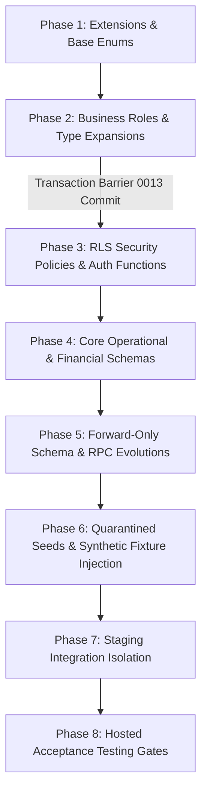

# T1-02: Staging Dependency Order, Data Quarantine & Recovery Plan

**Date:** 20 November 2026 (Nepal Time)  
**Assigned to:** Windows Antigravity / Full Runner  
**Repository:** `babindulal7/babin-rentals-os`  
**Starting Baseline:** Git commit `11253bf6a6ebeb292930926b09f1ad06715f9d11` (`origin/main`)  
**Staging Project Target:** `babin-staging` — `klhmsrunqrdxjudyhnkm`  
**Production Project Target:** `sxguwvgoserhdolewibb` (**STRICTLY UNMODIFIED / READ-ONLY AUDIT ONLY**)  
**Status:** **DRAFT PLAN & OFFLINE AUDIT ONLY — STAGING APPLICATION NOT APPROVED (0 HOSTED WRITES)**

---

## 1. Executive Summary & Settled Product Rulings

This document provides a fail-closed, per-file dependency analysis, transaction barrier inventory, sensitive seed quarantine specification, and recovery runbook for the 242 PostgreSQL migrations in `babin-rentals-os`.

As ruled by the business owner, the following baseline parameters are settled:
1. **Phase 1 Operational Scope:** Desktop/counter-PC use, manual equipment lookup/selection, secure bookings, packing, handover, return/reset, inventory, payments, paper-invoice references, staff roles and audit.
2. **Phase 2 Deferred Hardware Scope:** Physical iPad acceptance, Bluetooth/barcode/camera scanners, physical shop/label printers, native device-share hardware testing. These are deferred until after live and do **not** block Phase 1.
3. **Official VAT Invoices:** Pre-printed paper VAT invoice books continue as the sole legal tax series. The OS records actual paper invoice numbers with duplicate prevention and audit; quote/pro-forma/packing/agreement PDFs do not become a parallel official tax-invoice series.
4. **Accounting Rulings:** Authorized TDS confirmation; corrections preserving issued records; separate refundable security-deposit liability ledger; daily/monthly accountant package; dedicated non-destructive Accountant permission model; staged accountant sign-off and separate owner activation approval.
5. **No Production Release Authorization:** Owner approval of product requirements does not approve any Supabase migration or production deployment. Zero remote writes are authorized by this document.

---

## 2. Ordered Migration Phases (Not a Blind List)

A blind lexical sort (`0001` to `0244`) is an artifact of file naming and PGlite test harness conventions; it is **not** an independently verified hosted execution plan. The migrations must be conceptually grouped and gated into distinct structural phases:



### Phase 1: Extensions & Foundation Types (`0001_enums.sql`)
- Installs necessary PostgreSQL extensions (`pgcrypto`, `btree_gist` for exclusion constraints).
- Defines foundation types and enums (`booking_status`, `item_condition`, `payment_method`, `system_role`).
- **Dependencies:** PostgreSQL server environment.

### Phase 2: Role Vocabulary Expansion (`0013_business_8_roles.sql`)
- Transitions the Foundation 6 roles to the Business 8:
  - `Owner`, `Admin`, `Coordinator`, `Warehouse`, `Technician`, `Accounts`, `Driver`, `Client`.
- Renames historical labels in place to preserve existing policy references.
- **Transaction Barrier:** PostgreSQL requires that `ALTER TYPE ... ADD VALUE` statements be committed before the newly added enum members can be used in any subsequent SQL commands or policy definitions.

### Phase 3: RLS Security Policies & Auth Helpers (`0011_rls_policies.sql`, `0014_business_8_policies.sql`)
- Enables Row Level Security on core application tables.
- Implements `auth_user_role()`, `auth_user_id()`, `auth_can_view_money()`, `auth_is_staff()`.
- **Precondition:** Phase 2 enum additions must be fully committed.

### Phase 4: Core Operational & Financial Tables (`0002`–`0010`)
- Tables for `branches`, `warehouses`, `storage_zones`, `users`, `categories`, `products`, `product_units`.
- Tables for `bookings`, `booking_lines`, `booking_crew_lines`, `inventory_reservations`.
- Tables for `invoices`, `invoice_lines`, `payments`, `security_deposits`, `audit_events`.
- **Precondition:** Base schemas and security helper functions.

### Phase 5: Forward-Only Schema & RPC Evolutions (`0015`–`0244`)
- Structural migrations extending booking workflows, delivery routes, downtime, and operational gates.
- Includes key security and business logic additions:
  - `0163_close_six_anon_business_rpcs.sql`: Closes 6 anonymous business RPC entry points.
  - `0188_smart_reservation_holds.sql`: Adds GiST exclusion for active holds and atomic confirmation RPC.
  - `0188_staff_renting_gear.sql`: Adds staff client discount enum and client views.
  - `0241_extension_clash_manager_decision_and_at_risk.sql`: Adds extension clash decisions, at-risk booking tracking, and the P0 Coordinator credit/refund block.
  - `0244_counter_sale.sql`: Implements consumable walk-in counter sales with atomic stock deduction and draft invoice creation.

### Phase 6: Quarantined Seeds & Minimal Synthetic Fixtures
- **Original Seeds 0012, 0047, 0082 MUST NOT BE REPLAYED BLINDLY.**
- Safe non-deliverable synthetic replacements (`0012_seed_data.synthetic.sql`) injected for branch/user bootstrap.

### Phase 7: Staging Integration Isolation
- Hard shut-off of all outbound email, SMS, WhatsApp, webhooks, and live payment processing.

### Phase 8: Hosted Acceptance Testing
- Executed on `klhmsrunqrdxjudyhnkm` after verified completion of Phases 1–7.

---

## 3. Transaction Barriers & Dependency Nuances

### 3.1 The 0013 → 0014 Committed Enum Barrier
- `0013_business_8_roles.sql` adds `'Technician'` and `'Driver'` to `system_role` via `ALTER TYPE public.system_role ADD VALUE`.
- `0014_business_8_policies.sql` defines policies and helper functions (`auth_is_staff()`) that explicitly cast or compare against `'Technician'` and `'Driver'`.
- **Postgres Rule (Error 55P04):** A new enum value cannot be referenced in expressions within the transaction block where it was added.
- **Enforcement:** `0013` must be applied in a discrete transaction and committed. `0014` must be applied in a separate transaction. An installer script that attempts to bundle both into a single transaction will fail.

### 3.2 Duplicate Numeric Prefix: The Two 0188 Migrations
The repository contains two distinct migrations sharing prefix `0188`:
1. `0188_smart_reservation_holds.sql` (15,989 bytes, SHA-256: `6a65a57ee70bf9504af10c07d669e60dc180cdfcebca6a9f6891d7eb838e9c74`)
   - Schema additions to `inventory_reservations` (`hold_state`, `expires_at`).
   - Updates GiST exclusion constraint `inventory_reservations_no_double_booking`.
   - Adds RPCs: `confirm_booking_atomic`, `create_or_extend_hold`, `release_hold`.
2. `0188_staff_renting_gear.sql` (8,938 bytes, SHA-256: `272e75c66aa2ee7626cc5a0858ad6036ecb22c860bdf10bfead5e09b8521ba80`)
   - Adds `'Staff'` value to `discount_source` enum.
   - Adds `is_staff` and `staff_user_id` to `public.clients`.
   - Recreates views `clients_v` and `client_directory_v`.
- **Decision & Block:** Neither file may be renamed, deleted, or skipped. While offline PGlite tests execute them in lexical sequence (`smart_reservation_holds` then `staff_renting_gear`), their hosted execution order must be explicitly reviewed and ledger-tracked. Furthermore, `0188_staff_renting_gear.sql` contains an enum addition (`ALTER TYPE discount_source ADD VALUE 'Staff'`) requiring its own transaction boundary before any queries use `'Staff'`.

### 3.3 Anonymous RPC Closure (`0163_close_six_anon_business_rpcs.sql`)
Closes unauthenticated access to six business RPCs discovered during security audit:
1. `public.adjust_stock(uuid, integer, text, uuid, uuid)`
2. `public.portal_claim_by_verified_email()`
3. `public.read_quote_editor(text)`
4. `public.set_staff_active(uuid, boolean)`
5. `public.set_staff_role(uuid, public.system_role)`
6. `public.update_rental_quote(uuid, text, uuid, jsonb)`
- **Verification Gate:** Verifies that `anon` has no execute privilege on any overload of these functions, while `authenticated` retains execute rights.

### 3.4 Coordinator Monetary Guard in 0241 (`0241_extension_clash_manager_decision_and_at_risk.sql`)
- Guard merged in source:
  ```sql
  if (v_resolution in ('credit', 'refund') or v_credit_amount > 0)
     and v_role not in ('Owner', 'Admin', 'Manager') then
    raise exception 'resolve_booking_at_risk: monetary credit or refund resolution requires Owner, Admin or Manager.'
      using errcode = '42501';
  end if;
  ```
- **Staging Test Required:** Negative test asserting that an authenticated session with role `Coordinator` receives a 42501 refusal when attempting to declare credit or refund resolutions.

### 3.5 Counter Sale RPC in 0244 (`0244_counter_sale.sql`)
- Adds `booking_kind` (`'rental'`, `'counter_sale'`) to `public.bookings`.
- Atomic RPC `create_counter_sale(jsonb)`:
  - Deducts consumable stock with movement type `'Deduction'`.
  - Creates draft invoice via `resync_draft_invoice`.
  - Enforces money blindness: Warehouse and Technician roles receive no pricing or amount fields.
  - Idempotent via `client_uuid`.
- Pre-payment cancellation RPC `cancel_counter_sale`:
  - Reverses stock deduction via `'Restoration'`.
  - Voids draft invoice preserving audit log.

---

## 4. Large & Historical Seed Data Quarantine Specification

| Seed File | File Size | Contents & Risk Classification | Safe Staging Treatment |
| --- | --- | --- | --- |
| `0012_seed_data.sql` | 9.1 KB | Fixed seed branches, warehouses, user accounts, personal emails, PAN, bank accounts. | **DO NOT APPLY ORIGINAL.** Inspect `scripts/create-synthetic-staging-0012.mjs`. Use only the synthetic review fixture with `@example.invalid` emails, sanitized PANs, and non-deliverable phone/bank tokens. |
| `0047_seed_reference_corpus.sql` | 1.87 MB | Generated reference dataset populating 15 tables: `clients`, `products`, `product_units`, `bookings`, `booking_lines`, `booking_line_units`, `booking_crew_lines`, `audit_events`, `booking_discounts`, `invoices`, `invoice_lines`, `security_deposits`, `deposit_movements`, `payments`, `booking_stage_transitions`. | **QUARANTINE FROM STAGING.** Exclude from automatic installation. Schema compatibility must be validated using minimal synthetic fixtures. Do not run `npm run seed:sql`. |
| `0082_seed_operational_stage_corpus.sql` | 12.4 KB | Historical date-relative booking inserts; references historical `0076` corpus. | **QUARANTINE FROM STAGING.** Exclude from automatic installation. Booking stage transitions must be exercised via real RPC lifecycle tests, not historical static snapshots. |

---

## 5. Staging Backup, Checkpoints & Recovery Runbook

### 5.1 Pre-Installation Staging Baseline Snapshot
Before executing any SQL on project `klhmsrunqrdxjudyhnkm`:
1. Export complete schema dump:
   ```bash
   # Read-only snapshot of initial staging catalog (to be run only by Owner)
   pg_dump --schema-only --no-owner --no-privileges > staging_pre_install_catalog_baseline.sql
   ```
2. Verify `supabase_migrations.schema_migrations` table state (record count and migration names).
3. Record current active database connection strings and project reference.

### 5.2 Phase-by-Phase Checkpointing
During any authorized staging run, checkpoints must be captured after each phase:
- **Checkpoint 1 (Post-Phase 1):** Base enums and extensions verified.
- **Checkpoint 2 (Post-Phase 2 & 3):** `0013` committed, `0014` committed, RLS active.
- **Checkpoint 3 (Post-Phase 4):** Core relational schema established.
- **Checkpoint 4 (Post-Phase 5):** All 242 schema migrations applied and verified against SHA-256 manifest.
- **Checkpoint 5 (Post-Phase 6):** Synthetic fixtures applied.

### 5.3 Stop & Restore Criteria (Failure Recovery)
Execution must halt immediately if:
- Any migration script fails to execute or returns an SQL error.
- SHA-256 checksum of any local migration file differs from the pinned manifest.
- An enum usage failure (e.g. 55P04) or transaction abort occurs.
- A seed file leaks real contact, PAN, or banking information.
- RLS leak is detected during post-phase automated testing.

**Recovery Procedure:**
1. If failure occurs during schema phase: perform a clean reset of the staging project database to baseline:
   - Supabase staging project reset via dashboard or controlled reset command.
2. If failure occurs during synthetic fixture phase:
   - Run `STAGING_0012_SYNTHETIC_0013_ROLLBACK_2026-11-17.md` or truncate synthetic test records.
3. **Recovery Verification Status:**
   - **NOT VERIFIED ON HOSTED STAGING.** A full hosted backup/restore drill has not yet been executed on `klhmsrunqrdxjudyhnkm`. It is documented here as a required pre-condition before live cutover.

---

## 6. Outbound Integration Isolation Specification

To ensure staging never interacts with real customers, suppliers, or external services:

1. **Email Service (Resend / SendGrid / SMTP):**
   - Staging configuration must use blackhole/mock transport (`VITE_EMAIL_MOCK=true`).
   - All email domains must be restricted to `@example.invalid` or `@test.local`.
   - Real API keys must not be provisioned in staging Supabase Vault or environment secrets.
2. **SMS & WhatsApp Services:**
   - Twilio / Sparrow SMS credentials must be set to mock/disabled.
   - Staging mobile numbers must be non-routable strings (e.g., `STAGING-PHONE-HQ`).
3. **Payment Gateways (eSewa / Khalti / ConnectIPS / Bank):**
   - Live merchant keys strictly forbidden.
   - Only test sandbox credentials or local mock payment handlers allowed.
4. **Outbound Webhooks:**
   - All external webhook dispatching tables/triggers disabled or redirected to `http://localhost:9999/null`.
5. **PII Scrubbing:**
   - Database and application logs must be scrubbed of customer names, phones, and financial identifiers.

---

## 7. Hosted Acceptance Criteria (To Be Executed After Authorized Install)

Once an installation is authorized and completed on `klhmsrunqrdxjudyhnkm`, the following tests must pass:
- [ ] **Role Isolation:** Staff roles (Owner, Admin, Coordinator, Warehouse, Technician, Accounts, Driver) and external Client role verify distinct RLS boundaries.
- [ ] **Client A vs Client B Isolation:** Client session A cannot view, query, or mutate Client B bookings, quotes, or KYC docs.
- [ ] **Money Blindness:** Warehouse, Technician, and Driver roles receive null/masked monetary amounts on all views and RPC outputs.
- [ ] **Coordinator Monetary Block (P0):** Coordinator role receives error `42501` when attempting credit or refund resolutions on `resolve_booking_at_risk`.
- [ ] **No-Double-Booking Constraint:** GiST exclusion constraint prevents overlapping reservations for the same asset during confirmed stages or active holds.
- [ ] **Desktop Floor Loop:** Manual booking creation -> pack -> handover -> return flow succeeds without hardware scanner requirements.
- [ ] **Counter Sale Execution:** Consumable sale deducts stock, creates draft invoice, and prevents unauthoritative price tampering.
- [ ] **Paper VAT Invoice Capture:** Recording pre-printed paper VAT invoice book numbers enforces unique constraint and audit trail; does not mint electronic invoice sequence.
- [ ] **Deposit Ledger:** Security deposits tracked strictly as balance sheet liabilities; never credited to rental income.

---

## 8. Owner Staging Authorization Form (Blank Template)

*This section must be completed and signed by the business owner before ANY hosted execution on `klhmsrunqrdxjudyhnkm`.*

```
================================================================================
STAGING INSTALLATION AUTHORIZATION — BABIN RENTALS OS
================================================================================

Target Project ID:        klhmsrunqrdxjudyhnkm (babin-staging)
Git Commit SHA:           11253bf6a6ebeb292930926b09f1ad06715f9d11
Migration File Count:     242 SQL files
SHA-256 Manifest:         docs/verification/T1-02_STAGING_APPLY_MANIFEST_DRAFT_2026-11-20.json

Seed Handling Approved:
  [ ] 0012: Synthetic fixture only (scripts/create-synthetic-staging-0012.mjs)
  [ ] 0047: Quarantined (excluded from automated apply)
  [ ] 0082: Quarantined (excluded from automated apply)

Integration Isolation Verified:
  [ ] Outbound email / SMS / WhatsApp / Payment gateways disabled

Owner Signature:          ____________________________________________
Date Signed:              ____________________________________________
Approval Scope:           STAGING ONLY (klhmsrunqrdxjudyhnkm). 
                          EXPLICITLY DOES NOT AUTHORIZE PRODUCTION.
================================================================================
```
