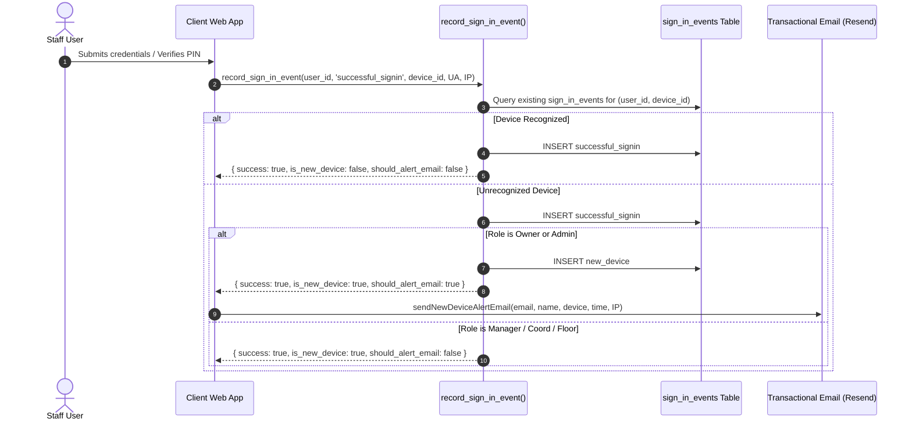

# T1-18 Design Note: Sign-In History and New-Device Email Security Architecture

**Card:** T1-18 · Sign-in history and new-device email  
**Status:** Security Design Review  
**Lanes:** Lane A (Codex-1 / Babin)  
**Authority:** `RULINGS-2026-10-27-booqable.md` (B22, B23, B54) · `docs/PERMISSIONS.md` · `CLAUDE.md` (N-5, N-8, Law 1, Law 3)  
**Date:** 2026-11-23

---

## 1. Executive Summary

Card T1-18 delivers two critical operational security capabilities for Babin Rentals OS:
1. **Server-Enforced Sign-In History (B22):** An immutable, tamper-resistant audit trail of authentication attempts (successful sign-ins, failed attempts, PIN switches, and new-device recognitions) displayed in **Settings ▸ People & Access**, readable strictly by `Owner` and `Admin`.
2. **New-Device Security Alerts (B23):** Automated real-time email dispatch via Resend triggered exclusively on the **first sign-in of an `Owner` or `Admin` account from an unrecognised device**. Other staff roles (`Manager`, `Coordinator`, `Accounts`, `Warehouse`, `Technician`, `Driver`, `Client`) never trigger email notifications.

Per project security protocol, this design note documents the threat model, permissions matrix, database schema, notification triggers, and fail-closed architecture prior to implementation.

---

## 2. Threat Model & Mitigations

| Threat | Description | Mitigation |
|---|---|---|
| **T-1: Credential Stuffing & Brute Force** | Attacker attempts multiple passwords or PINs against staff accounts. | Failed attempts are logged server-side with client IP and user agent. PIN verification rate limiting (`verify_staff_pin`) locks out after threshold. Owner/Admin can inspect failed attempts in real time. |
| **T-2: Account Takeover (ATO)** | Stolen credentials used to sign in as Owner or Admin from an attacker's browser/machine. | Device recognition identifies the new hardware fingerprint. An immediate alert email is dispatched to the victim's verified inbox specifying time, browser, OS, and IP address. |
| **T-3: Audit Tampering & Log Deletion** | Compromised user or rogue insider attempts to alter or delete sign-in history to conceal unauthorized access. | Direct `INSERT`, `UPDATE`, and `DELETE` on `sign_in_events` are strictly `REVOKE`d from all users (`authenticated` and `anon`). Writes happen solely through an append-only `SECURITY DEFINER` RPC. |
| **T-4: PII & Credential Exfiltration (N-8)** | Logs inadvertently store passwords, PINs, OTP tokens, or full session JWTs. | **Strict Rule N-8:** Passwords, PINs, and token values are scrubbed at the gateway and never passed to the persistence layer. The table stores only identity IDs, device hashes, user agents, IP addresses, and event outcome enums. |
| **T-5: Cross-Role Information Disclosure** | Floor or managerial staff view executive logins, IP addresses, or work schedules. | RLS strictly restricts `SELECT` to `Owner` and `Admin`. Managers and other roles query 0 rows (`auth_user_role() in ('Owner', 'Admin')`). Tested via real Postgres lifecycle gates. |
| **T-6: Alert Spam / DoS on Email Dispatch** | Repeated logins or flapping connections from the same device spam Owner/Admin inboxes. | Deduplication: Alerts only trigger on *first-seen* device IDs for that specific user. Once logged, subsequent sign-ins from that device do not trigger emails. |

---

## 3. Permissions & Access Control Matrix

Following `docs/PERMISSIONS.md` and R-22 / R-23:

| Role | Read Sign-In History | Write Sign-In Events | Receive New-Device Alert Email |
|---|---|---|---|
| **Owner** | **Allowed** (Full organization history) | Server RPC only | **Yes** (On unrecognized device) |
| **Admin** | **Allowed** (Full organization history) | Server RPC only | **Yes** (On unrecognized device) |
| **Manager** | **DENIED (0 rows)** | Server RPC only | No (B23) |
| **Coordinator** | **DENIED (0 rows)** | Server RPC only | No (B23) |
| **Accounts** | **DENIED (0 rows)** | Server RPC only | No (B23) |
| **Warehouse** | **DENIED (0 rows)** | Server RPC only | No (B23) |
| **Technician** | **DENIED (0 rows)** | Server RPC only | No (B23) |
| **Driver** | **DENIED (0 rows)** | Server RPC only | No (B23) |
| **Client / Anon**| **DENIED (0 rows)** | Server RPC only | No (B23) |

---

## 4. Database Architecture (Migration 0268)

### 4.1 Table Schema: `public.sign_in_events`

```sql
create table if not exists public.sign_in_events (
  id uuid primary key default gen_random_uuid(),
  user_id uuid not null references public.users (id) on delete cascade,
  event_kind text not null check (event_kind in ('successful_signin', 'failed_signin', 'pin_switch', 'new_device')),
  device_id text not null,                -- SHA-256 fingerprint / T1-15 device session key
  user_agent text,                       -- Parsed browser & OS summary
  ip_address text,                       -- Client IP recorded from transport
  metadata jsonb not null default '{}'::jsonb, -- Parsed device metadata (browser, os, device_name)
  created_at timestamptz not null default now()
);

-- Indexes for performant filtering & deduplication
create index if not exists idx_sign_in_events_user_created 
  on public.sign_in_events (user_id, created_at desc);

create index if not exists idx_sign_in_events_device_lookup 
  on public.sign_in_events (user_id, device_id);

create index if not exists idx_sign_in_events_created 
  on public.sign_in_events (created_at desc);
```

### 4.2 Row-Level Security (RLS) Policies

```sql
alter table public.sign_in_events enable row level security;

-- Read policy: Owner and Admin only (B22)
create policy sign_in_events_select on public.sign_in_events 
  for select to authenticated
  using (public.auth_user_role() in ('Owner', 'Admin'));

-- Disallow all direct client writes (even authenticated)
revoke insert, update, delete on public.sign_in_events from public, anon, authenticated;
grant select on public.sign_in_events to authenticated;
```

### 4.3 Write Gateway: `record_sign_in_event` RPC

An append-only `security definer` function to record sign-in events:
```sql
create or replace function public.record_sign_in_event(
  p_user_id uuid,
  p_event_kind text,
  p_device_id text,
  p_user_agent text default null,
  p_ip_address text default null,
  p_metadata jsonb default '{}'::jsonb
)
returns jsonb
language plpgsql
security definer
set search_path = public, pg_temp
as $$
declare
  v_is_new_device boolean := false;
  v_user_role text;
  v_user_email text;
  v_user_name text;
begin
  -- Validate event kind
  if p_event_kind not in ('successful_signin', 'failed_signin', 'pin_switch', 'new_device') then
    raise exception 'Invalid sign-in event kind: %', p_event_kind using errcode = '22023';
  end if;

  -- Lookup user role & details
  select primary_role, email, full_name 
  into v_user_role, v_user_email, v_user_name
  from public.users 
  where id = p_user_id;

  if v_user_role is null then
    raise exception 'User not found: %', p_user_id using errcode = '22023';
  end if;

  -- Check if this device is recognized for this user
  if p_event_kind = 'successful_signin' then
    if not exists (
      select 1 from public.sign_in_events 
      where user_id = p_user_id and device_id = p_device_id
    ) then
      v_is_new_device := true;
    end if;
  end if;

  -- Insert the primary event
  insert into public.sign_in_events (
    user_id, event_kind, device_id, user_agent, ip_address, metadata, created_at
  ) values (
    p_user_id, p_event_kind, p_device_id, p_user_agent, p_ip_address, p_metadata, now()
  );

  -- If this is a new device for Owner or Admin, record the 'new_device' marker event
  if v_is_new_device and v_user_role in ('Owner', 'Admin') then
    insert into public.sign_in_events (
      user_id, event_kind, device_id, user_agent, ip_address, metadata, created_at
    ) values (
      p_user_id, 'new_device', p_device_id, p_user_agent, p_ip_address, p_metadata, now()
    );
  end if;

  return jsonb_build_object(
    'success', true,
    'is_new_device', v_is_new_device,
    'should_alert_email', (v_is_new_device and v_user_role in ('Owner', 'Admin')),
    'user_role', v_user_role,
    'email', v_user_email,
    'name', v_user_name
  );
end;
$$;
```

---

## 5. New-Device Email Dispatch Workflow



### 5.1 Email Content Specification
- **Subject:** `[Security Alert] New sign-in to Babin Rentals OS`
- **Recipient:** `Owner` or `Admin` user email.
- **Body Details:**
  - Staff Full Name & Role
  - Device info: Operating System & Browser (parsed from User-Agent)
  - IP Address
  - Timestamp in Nepal Standard Time (NPT) and UTC
  - Call to action: *"If you did not perform this sign-in, please notify Babin immediately and reset your password."*

---

## 6. UI Integration: Settings ▸ People & Access

1. **Access Gate:** Rendered only if `canViewSignInHistory(userRole)` is `true` (`Owner` or `Admin`).
2. **Table Display:** Shows the last 50 sign-ins with:
   - Date & Time (formatted with NPT indicator)
   - Staff Name & Role badge
   - Event Status (Green: `Successful`, Red: `Failed`, Blue: `PIN Switch`, Orange: `New Device`)
   - Device & Browser summary (e.g. `Chrome 122 on macOS`, `Safari on iPadOS`)
   - IP Address
3. **Five Screen States:**
   - Loading: Skeleton table.
   - Empty: *"No recent sign-in events recorded."*
   - Error: Inline banner with retry button.
   - Restricted: Hidden from navigation or rendered as 403 Restricted for Manager/Floor.
   - Offline: Read cached events from IndexedDB (read-only snapshot).

---

## 7. Verification & Acceptance Criteria

1. **PGLite Rebuild & RLS:** `npm run check:pglite` passes with migration 0268.
2. **Lifecycle Gate:** Step asserting that:
   - `Owner` queries `sign_in_events` and sees audit rows.
   - `Manager` queries `sign_in_events` and receives **0 rows**.
   - Direct `insert` from `authenticated` user throws permission denied.
3. **Automated Unit & Integration Tests:**
   - `loginAudit.test.ts` asserts `evaluateNewDeviceAlert()` and role permissions.
   - Server contract tests assert RPC signatures and error codes.
4. **Resend Email Test:** Verified that dispatch fires for Owner on first-seen device, and subsequent sign-ins from the same device do not emit an email.
