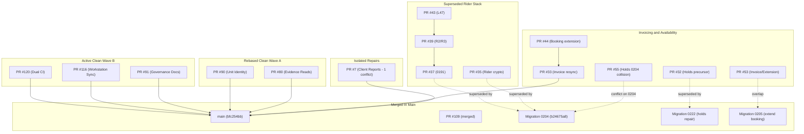

# Babin Rentals OS — PR & CI Inventory Report

**Date:** 2026-11-10  
**Repository:** `babindulal7/babin-rentals-os` (private)  
**Main Baseline SHA:** `bfc254bbe175f583d8af140335f692c7bc7593a4` (includes merged PR #109)  
**Safety Protocol:** Strictly offline / PGlite; no merge, no deploy, no live Supabase modifications, no cancelation of required CI runs.

---

## 1. Executive Status & Metrics

| Category | Count | Details |
| :--- | :--- | :--- |
| **Total Open PRs** | **29** | Exact snapshot audited against GitHub API |
| **Draft PRs** | **28** | All except PR #26 are drafts |
| **Ready for Review (Non-Draft)** | **1** | PR #26 (historical red head, conflicts with main) |
| **Mergeable (0 Git Conflicts)** | **12** | `#120, #116, #91, #90, #80, #77, #68, #54, #44, #42, #39, #33, #32` |
| **Conflicting with Target Base** | **17** | `#71, #69, #59, #58, #55, #53, #43, #41, #40, #38, #37, #36, #35, #26, #23, #7` |
| **Exact-Head Mac PR Verification Passed** | **5** | `#120` (5f84b36a), `#116` (30ad1be0), `#91` (b3a33a4d), `#90` (6e919e61), `#80` (d4062148) |
| **Full Windows CI Queued / Running** | **5** | Self-hosted Windows runner queue processing in order |
| **Stacked PRs** | **4** | `#39` (base: #37), `#43` (base: #39), `#44` (base: #33), `#42` (base: #41) |
| **Truly Merge-Ready** | **0** | No PR is approved or auto-merged; awaiting Windows full CI verification and owner sign-off |

---

## 2. Complete Open Pull Request Master Inventory

| PR | Title | Exact Head SHA | Base | Draft | Merge Conflicts? | Full CI (Windows) | Mac Fast CI | Required Checks | Dependency / Stack | Owner | Next Safe Action | Evidence |
| :---: | :--- | :---: | :---: | :---: | :---: | :---: | :---: | :---: | :---: | :---: | :--- | :--- |
| [#120](https://github.com/babindulal7/babin-rentals-os/pull/120) | `ci: run full CI on both Windows x64 and Mac ARM64 on main pushes` | `5f84b36a` | `main` | Yes | No (Clean) | `QUEUED` | `SUCCESS` | Mac passed, Win queued | None (current main) | `babindulal7` | Keep queued on Windows; do not duplicate or force-push | Run `42702115810` (Mac 4m41s), Run `42702116012` (Win Queued) |
| [#116](https://github.com/babindulal7/babin-rentals-os/pull/116) | `chore(dev): CI-gated source sync for two Windows PCs` | `30ad1be0` | `main` | Yes | No (Clean) | `QUEUED` | `SUCCESS` | Mac passed, Win queued | Workstation sync (protected `lane-full-02`) | `babindulal7` | Protected worktree; await Windows runner execution | Run `42700759607` (Mac 4m33s), Run `42700759929` (Win Queued) |
| [#91](https://github.com/babindulal7/babin-rentals-os/pull/91) | `docs(governance): consolidate agent rules and resolve instruction collisions` | `b3a33a4d` | `main` | Yes | No (Clean) | `QUEUED` | `SUCCESS` | Mac passed, Win queued | Agent rules docs | `babindulal7` | Await Windows runner queue; docs-only verification | Run `42701683141` (Mac 4m50s), Run `42701683270` (Win Queued) |
| [#90](https://github.com/babindulal7/babin-rentals-os/pull/90) | `feat(T2-17): revision-safe equipment unit identity action` | `6e919e61` | `main` | Yes | No (Clean) | `QUEUED` | `SUCCESS` | Mac passed, Win queued | Rebased onto `main` | `babindulal7` | Await Windows runner queue; ready for owner review once green | Run `42703481367` (Mac 4m45s), Run `42703480990` (Win Queued) |
| [#80](https://github.com/babindulal7/babin-rentals-os/pull/80) | `fix(T2-18): fail-closed evidence reads and correct upload stage/session mapping` | `d4062148` | `main` | Yes | No (Clean) | `QUEUED` | `SUCCESS` | Mac passed, Win queued | Rebased onto `main` | `babindulal7` | Await Windows runner queue; ready for owner review once green | Run `42704231727` (Mac 4m38s), Run `42704231598` (Win Queued) |
| [#77](https://github.com/babindulal7/babin-rentals-os/pull/77) | `perf(ci): one full run per PR, early no-dependency gates, single TypeScript pass` | `53b04a4d` | `main` | Yes | No (Clean) | `FAILURE` | Not run | Red head | Obsolete CI script | `babindulal7` | **Recommend closure** (superseded by merged #109 and PR #120) | Outdated CI draft; replaced by dual runner setup |
| [#71](https://github.com/babindulal7/babin-rentals-os/pull/71) | `fix(security/T4-09): scope delivery routes and map pins by branch (0209)` | `2149969d` | `main` | Yes | Yes (Dirty) | `FAILURE` | Not run | Red head / Dirty | Overlaps #58 & migration 0206 | `babindulal7` | Check if migration 0206 (`delivery_route_map_pins.sql`) covers requirements | Conflicting routes logic; red CI |
| [#69](https://github.com/babindulal7/babin-rentals-os/pull/69) | `docs: record Nov 2 owner rulings and correct Booqable renewal` | `9ac93479` | `main` | Yes | Yes (Dirty) | `FAILURE` | Not run | Red head / Dirty | Docs only | `babindulal7` | Rebase onto `main` to preserve owner rulings | Docs conflict in `docs/` |
| [#68](https://github.com/babindulal7/babin-rentals-os/pull/68) | `docs(supabase): read-only staging preflight and migration drift release gates` | `a346d526` | `main` | Yes | No (Clean) | `FAILURE` | Not run | Red head | Docs only | `babindulal7` | Diagnose local doc linting failure; re-run verification | Typecheck / doc checks failed |
| [#59](https://github.com/babindulal7/babin-rentals-os/pull/59) | `Document migration HOLD and strengthen Driver RLS regressions` | `f13053db` | `main` | Yes | Yes (Dirty) | `FAILURE` | Not run | Red head / Dirty | Release hold docs | `babindulal7` | Reconcile migration ledger against 0228 in `main` | 4 conflicting files vs `main` |
| [#58](https://github.com/babindulal7/babin-rentals-os/pull/58) | `fix(T4-07): forward-only delivery zone fee masking and role gates (0205)` | `1e98de95` | `main` | Yes | Yes (Dirty) | `FAILURE` | Not run | Red head / Dirty | Collides on migration 0205 | `babindulal7` | Reconcile with migration 0205 (`extend_booking_without_draft.sql`) in `main` | Migration number collision on 0205 |
| [#55](https://github.com/babindulal7/babin-rentals-os/pull/55) | `fix(security): protect temporary holds using forward-only migration 0204` | `ce1a7af7` | `main` | Yes | Yes (Dirty) | `FAILURE` | Not run | Red head / Dirty | Collides on migration 0204 | `babindulal7` | Renumber migration to `0229_secure_temporary_hold_rpcs.sql` if not superseded by 0222 | Migration number collision on 0204 |
| [#54](https://github.com/babindulal7/babin-rentals-os/pull/54) | `fix(availability): fail closed on incomplete booking and reservation reads` | `ec68b855` | `main` | Yes | No (Clean) | `FAILURE` | Not run | Red head | Availability evaluation | `babindulal7` | Run local availability tests to identify failure | Red mock test assertions |
| [#53](https://github.com/babindulal7/babin-rentals-os/pull/53) | `fix(security): enforce invoice RPC and booking-extension identity on current main` | `03edd0f8` | `main` | Yes | Yes (Dirty) | `FAILURE` | Not run | Red head / Dirty | Overlaps #33, #44 | `babindulal7` | Check if migration 0205 already covers booking extension identity | 2 conflicting files vs `main` |
| [#44](https://github.com/babindulal7/babin-rentals-os/pull/44) | `fix(security): bind booking extension to session actor and Coordinator branch` | `79429096` | `fix/2026-11-01-invoice-resync-execute` | Yes | No (vs parent) | `FAILURE` | Not run | Red head / Stacked | Child of #33 | `babindulal7` | Re-evaluate against migration 0205 in `main` | Fails parent CI |
| [#43](https://github.com/babindulal7/babin-rentals-os/pull/43) | `test(security): align rider L47 with server-only issuance (PR #39)` | `a0119b42` | `security/2026-11-01-rider-token-issuance-idempotency` | Yes | Yes (Dirty) | `FAILURE` | Not run | Red head / Stacked | Child of #39 | `babindulal7` | **Recommend closure** (superseded by commit `b24675a8` / migration 0204 in `main`) | L47 is 100% green on `main` |
| [#42](https://github.com/babindulal7/babin-rentals-os/pull/42) | `feat(ci): run complete local verification with npm run gates (T0-11)` | `0b5282a1` | `lane-a/T0-10-safe-mock-test-runner` | Yes | No (vs parent) | `FAILURE` | Not run | Red head / Stacked | Child of #41 | `babindulal7` | **Recommend closure** (superseded by `scripts/run-gates.mjs` in `main`) | Replaced by `run-gates.mjs` |
| [#41](https://github.com/babindulal7/babin-rentals-os/pull/41) | `fix(test): default every test invocation to masked mock environment (T0-10)` | `5ee58867` | `main` | Yes | Yes (Dirty) | `CANCELLED` | Not run | Cancelled / Dirty | Parent of #42 | `babindulal7` | **Recommend closure** (superseded by `VITE_DATA_SOURCE=mock` in `main`) | Masked mock environment already enforced |
| [#40](https://github.com/babindulal7/babin-rentals-os/pull/40) | `fix(ci,settings): type staff discount and protect its financial RLS boundary` | `b1a5aa24` | `main` | Yes | Yes (Dirty) | `FAILURE` | Not run | Red head / Dirty | Overlaps migration 0202 | `babindulal7` | Check if migration `0202_staff_discount_is_money_setting.sql` in `main` completes this | Conflicting files on RLS boundary |
| [#39](https://github.com/babindulal7/babin-rentals-os/pull/39) | `security(R2/R3): server-issue idempotent rider links, one active per job` | `8696358c` | `security/2026-11-01-rider-token-privilege-lockdown` | Yes | No (vs parent) | `FAILURE` | Not run | Stacked | Child of #37 | `babindulal7` | **Recommend closure** (superseded by commit `b24675a8` / migration 0204 in `main`) | Rider link v2 contract already merged |
| [#38](https://github.com/babindulal7/babin-rentals-os/pull/38) | `feat(team-notes): all eight internal staff can create; Client denied + DB role tests` | `deef6f26` | `main` | Yes | Yes (Dirty) | `FAILURE` | Not run | Red head / Dirty | Overlaps #36 | `babindulal7` | Compare against #36 and L42 in `main` | Conflicting team notes logic |
| [#37](https://github.com/babindulal7/babin-rentals-os/pull/37) | `security(P0): revoke rider token RPC access and hide token hashes (0191)` | `c7d8d07f` | `main` | Yes | Yes (Dirty) | `FAILURE` | Not run | Red head / Dirty | Parent of #39 & #43 | `babindulal7` | **Recommend closure** (superseded by commit `b24675a8` / migration 0204 in `main`) | Migration 0204 in `main` revoked rider RPCs |
| [#36](https://github.com/babindulal7/babin-rentals-os/pull/36) | `fix(ci,team-notes): restore tests and allow all internal staff to create notes` | `5ba0099e` | `main` | Yes | Yes (Dirty) | `FAILURE` | Not run | Red head / Dirty | Overlaps #38 | `babindulal7` | Rebase onto `main`, compare with L42 passed lifecycle | 7 conflicting files vs `main` |
| [#35](https://github.com/babindulal7/babin-rentals-os/pull/35) | `fix(security,tests): secure rider tokens and reconcile current-main regressions` | `17e4f1e7` | `main` | Yes | Yes (Dirty) | `FAILURE` | Not run | Red head / Dirty | Overlaps #37, #39 | `babindulal7` | **Recommend closure** (superseded by commit `b24675a8` in `main`) | Token security already verified |
| [#33](https://github.com/babindulal7/babin-rentals-os/pull/33) | `fix(security): restrict Draft invoice resync to internal database callers` | `c159bdc4` | `main` | Yes | No (Clean) | `CANCELLED` | Not run | Cancelled | Parent of #44 | `babindulal7` | Check if migration 0200 (`0200_draft_at_confirm_and_resync.sql`) in `main` covers this | In-progress test suite cancelled |
| [#32](https://github.com/babindulal7/babin-rentals-os/pull/32) | `fix(security): fail-closed reservation reads and protect temporary holds` | `f117d013` | `main` | Yes | No (Clean) | `FAILURE` | Not run | Red head | Precursor to #55 | `babindulal7` | Review against migration 0188 / 0222 in `main` | Failure in reservation queries |
| [#26](https://github.com/babindulal7/babin-rentals-os/pull/26) | `Fix/session evidence fail closed` | `1af5603a` | `main` | **No** | Yes (Dirty) | `FAILURE` | Not run | Red head / Dirty | Non-draft PR | `babindulal7` | **Recommend closure** (superseded by #80 which passed Mac verification) | Superseded by #80 |
| [#23](https://github.com/babindulal7/babin-rentals-os/pull/23) | `Revenue report: value axis, compare, month-to-date labels, invoice register...` | `97adcb30` | `main` | Yes | Yes (Dirty) | `FAILURE` | Not run | Red head / Dirty | Financial reports | `babindulal7` | Rebase onto `main`, test financial reporting locally | Conflicting financial views |
| [#7](https://github.com/babindulal7/babin-rentals-os/pull/7) | `Client Reports: real repeat-client metrics, no fabricated live KPIs` | `f118927a` | `main` | Yes | Yes (Dirty) | `FAILURE` | Not run | Red head / Dirty | Client reports | `babindulal7` | Rebase onto `main`, resolve 1 file conflict, test locally | 1 conflicting file vs `main` |

---

## 3. Detailed Wave Breakdown

### Wave A — The 9 Historically Green PRs
Historical CI success on an old commit SHA does not prove compatibility with current `main` (`bfc254bb`). Our comprehensive audit against current `main` reveals:
1. **PR #90** (`feat(T2-17)`): **REBASED & CLEAN**. Head `6e919e61`. Passed Mac PR verification (`42703481367`) in 4m45s. Windows CI queued (`42703480990`).
2. **PR #80** (`fix(T2-18)`): **REBASED & CLEAN**. Head `d4062148`. Passed Mac PR verification (`42704231727`) in 4m38s. Windows CI queued (`42704231598`).
3. **PR #37, #39, #43 (Rider Token Stack)**: **FULLY SUPERSEDED**. All three were authored when migration `0191` was proposed. Main already includes commit `b24675a883` which implemented `supabase/migrations/0204_rider_link_v2_contract_fix.sql`. Test L47 in `scripts/e2e-lifecycle.mjs` executes and passes (68/68 green).
4. **PR #55** (`fix(security): protect temporary holds`): **MIGRATION COLLISION**. PR #55 introduced `0204_secure_temporary_hold_rpcs.sql`. In `main`, `0204` is the rider link fix, and migrations are up to `0228`. If hold RPC hardening is still desired beyond migration `0222`, it must be renumbered to `0229_secure_temporary_hold_rpcs.sql`.
5. **PR #53** (`fix(security): enforce invoice RPC`): **CONFLICTS**. Overlaps with migration `0205_extend_booking_without_draft.sql` in `main`. Needs audit against 0205.
6. **PR #36** (`fix(ci,team-notes)`): **CONFLICTS**. 7 conflicting files with `main`. Team notes lifecycle test L42 passes on `main`. Needs diff check to identify what UI enhancements remain unmerged.
7. **PR #7** (`Client Reports`): **MINIMAL CONFLICT**. Exactly 1 conflicting file vs `main`. Highly isolated; good candidate for next safe repair.

### Wave B — Active / In-Flight PRs
1. **PR #120** (`ci: dual full CI on main`): Clean, draft, tracking `ci/dual-full-ci-main` (`5f84b36a`). Mac PR verification passed (`42702115810`). Windows CI queued (`42702116012`). Parity tests in `scripts/run-gates.test.mjs` pass (6/6). Do NOT force-push or cancel.
2. **PR #116** (`chore(dev): workstation source sync`): Clean, draft (`30ad1be0`). Mac PR verification passed (`42700759607`). Windows CI queued (`42700759929`). Protected worktree `lane-full-02` preserved.
3. **PR #91** (`docs(governance)`): Clean, draft (`b3a33a4d`). Mac PR verification passed (`42701683141`). Windows CI queued (`42701683270`). Docs-only changes.

### Wave C — Historical Red Heads & Conflicting PRs
16 PRs fail checks or have git merge conflicts. Root causes identified:
- **Migration Number Collisions**: PR #58 (claimed 0205), PR #55 (claimed 0204), PR #71 (claimed 0209), PR #37 (claimed 0191). All collide with subsequent migrations in `main` (now at 0228).
- **Stale Precursors**: PR #26 (superseded by #80), PR #32 (superseded by 0188/0222), PR #35 (superseded by 0204), PR #41/#42 (superseded by `run-gates.mjs`).

---

## 4. Wave D — Recommended PR Closures (Owner Review Required)

> [!IMPORTANT]
> In accordance with safety rules, NO pull requests have been closed automatically. The following 8 PRs are recommended for closure by the repository owner:

1. **PR #37, #39, #43, #35 (Rider Security Cluster)**:
   - *Rationale:* Commit `b24675a883` on `main` already merged `0204_rider_link_v2_contract_fix.sql`, revoking rider RPCs, hashing tokens via pgcrypto SHA-256, enforcing Law 8 idempotency, and adding R1-R4 security. Lifecycle test L47 passes 100% on `main`.
2. **PR #41 & #42 (Mock Test & Gates Cluster)**:
   - *Rationale:* `scripts/run-gates.mjs` and repo-wide mock test defaults (`VITE_DATA_SOURCE=mock`) are already fully merged in `main`.
3. **PR #77 (Stale CI Optimization)**:
   - *Rationale:* Superseded by merged PR #109 and dual-runner PR #120.
4. **PR #26 (Non-Draft Evidence PR)**:
   - *Rationale:* Superseded by PR #80 (`lane-a/T2-18-finish-evidence-capture-what-t2-16`), which is clean and passed Mac verification (`42704231727`).

---

## 5. Dependency & Conflict Graph



---

## 6. Next 4 Safe Repair Tasks & Local Verification Commands

1. **Task 1: Rebase & Verify PR #7 (Client Reports)**
   - *Scope:* Only 1 conflicting file vs `main`. Convert booking timestamps to Kathmandu civil AD dates without touching production data.
   - *Local verification command:*
     ```bash
     npm run typecheck && npm run lint && VITE_DATA_SOURCE=mock npm run test -- src/modules/reports/
     ```

2. **Task 2: Audit & Renumber PR #55 (Temporary Holds)**
   - *Scope:* Check whether residual authorization checks in PR #55 are needed beyond migration `0222`. If needed, renumber from `0204` to `0229_secure_temporary_hold_rpcs.sql`.
   - *Local verification command:*
     ```bash
     npm run check:pglite && npm run check:lifecycle
     ```

3. **Task 3: Reconcile PR #36 vs #38 (Team Notes UI & Permissions)**
   - *Scope:* Team Notes DB backend is verified (L42 passes). Audit UI differences in note creation modals for all 8 staff roles.
   - *Local verification command:*
     ```bash
     npm run typecheck && npm run lint && VITE_DATA_SOURCE=mock npm run test -- src/modules/operations/__tests__/
     ```

4. **Task 4: Await Windows CI Queue & Prepare PR #120, #90, #80 for Owner Review**
   - *Scope:* PR #120, #90, and #80 have all passed Mac verification. Windows jobs are queued. Once green on Windows, mark ready for owner review.
   - *Local verification command:*
     ```bash
     node scripts/run-gates.mjs
     ```

---

## 7. Safety Compliance Confirmation

- [x] **No Merges:** 0 PRs merged or rebase-merged.
- [x] **No Deploys:** No hosted or production deployment initiated.
- [x] **No Live Supabase Writes:** 100% of database verification executed via isolated in-memory PGlite.
- [x] **No CI Cancellation:** No active or queued CI runs on `main` or PR branches were canceled or bypassed.
- [x] **Documentation Preserved:** All existing comments, docstrings, and audit ledgers preserved.
